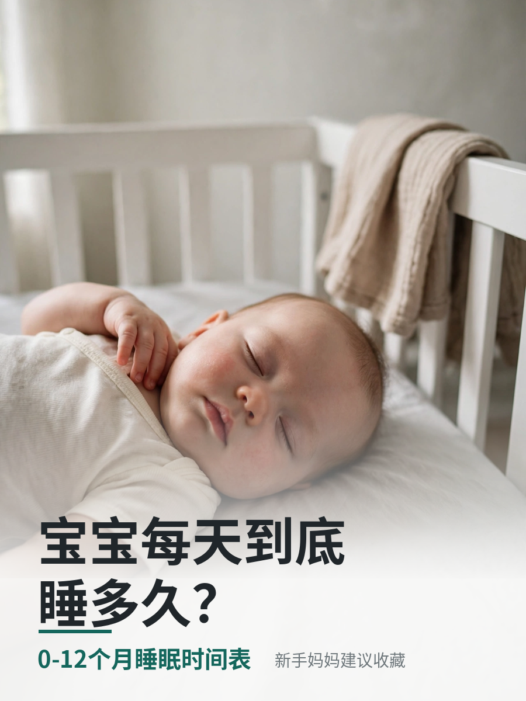
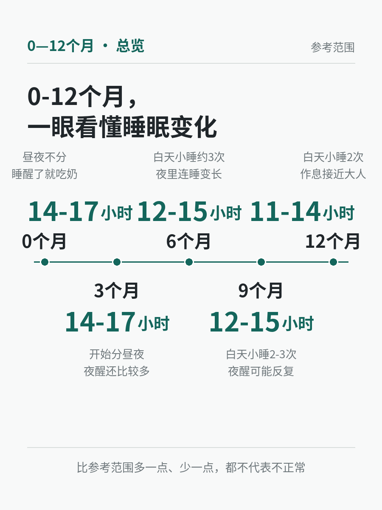
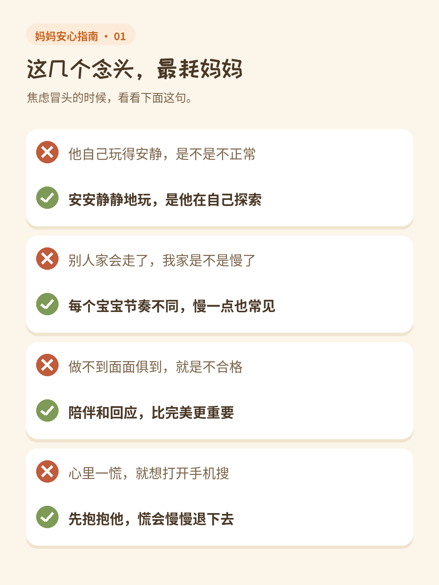

# 小红书生图工作流 · Xiaohongshu Visual Workflow

一套为小红书内容创作者打造的**图文生产工作流**：选题判断 → 标题 → 文案 → 视觉栏目选择 → AI 无字底图 → PIL 精准排版 → 交付自查。

它解决的核心问题是：**模板化生图让账号看起来像 AI 批量生产的模板号。**

固定的「米白底 + 手绘边框 + 插画 + 大标题 + 橙色重点字」用上三五篇还行，连用十篇，读者一眼就腻了，平台和用户都会给账号打上「批量模板号」的标签。这套工作流的答案是：**先判断内容属性，再决定视觉表现，用 7 个视觉栏目主动轮换。**

## 核心：多视觉栏目体系

每一篇笔记开工前，先判断内容属性（知识型 / 情绪型 / 故事型 / 好物型 / 记录型），再从 7 个栏目里选最贴合的一个：

| # | 视觉栏目 | 适合的内容 | 关键词 |
|---|---------|-----------|--------|
| 1 | 真实生活摄影感 | 家庭场景、好物实测 | 生活方式杂志、手机实拍感、自然皮肤纹理 |
| 2 | 高级杂志感 | 观点、盘点 | 大面积留白、摄影主体、精致排版、**无边框** |
| 3 | 极简信息图 | 睡眠、辅食、发育、月龄对照 | 时间轴、大数字、流程图 |
| 4 | 情绪故事感 | 深夜哄睡、第一次叫妈妈 | 单个真实场景、文字少、冲击力 |
| 5 | 轻漫画叙事 | 带娃日常、翻车现场 | 4~6 格、动作 + 对白讲故事 |
| 6 | 生活抓拍感 | 育儿日记、家庭记录 | 手机随手拍、不过度精致 |
| 7 | 创意视觉 | 差异化选题 | 拼贴、局部特写、物品隐喻、摄影＋文字 |

### 轮换硬规则

- 连续两篇**不得使用相同视觉结构**（用台账记录每篇栏目，见 `docs/layout-history-template.md`）
- 不要每篇都用米白色、不要每篇都用手绘插画、不要每篇都加边框、不要每篇都把标题放在最上方、不要每篇都用「标题＋插画＋知识点」结构
- 不为了账号统一而牺牲视觉变化——**识别度靠内容气质，不靠模板**。目标是读者觉得：「这个账号的每一篇都不一样，但一眼又知道是她家的内容。」
- 禁止明显的 AI 绘画质感、塑料感、过度磨皮、过度完美的家庭场景
- 判断顺序永远是「这篇内容最适合什么视觉」>「账号之前用了什么」

细节见 [`docs/visual-columns.md`](docs/visual-columns.md)。

## 技术路线：AI 只出无字底图，中文一律 PIL 排版

AI 生图模型写中文必乱码，这是结构性问题，靠提示词救不回来。本工作流的铁律：

1. AI 只生成**无文字**的底图 / 照片（prompt 固定带 `no text, no words, no typography, no watermark`）
2. 所有中文由 **PIL（Pillow）按给定文案精准排版**，字号、位置、颜色全部可控
3. 出图后逐张验字、验缩略图：标题和核心数字在手机信息流尺寸下必须可读
4. 内容太多时**删文字，不缩字体**

字体按栏目选：杂志 / 极简风用思源黑体（Noto Sans CJK）；手写感栏目可用站酷快乐体（标题）＋马善政体（正文），均为开源字体，见 [`fonts/README.md`](fonts/README.md)。

## 工作流（7 步）

1. **选题流量判断**：痛点浓度 / 情绪钩子 / 涨粉潜力 / 差异化 / 时效性
2. **5 个标题 + 点击分析**：6 个公式混搭，每个 ≤20 字，至少 2 个带提问或数字钩子
3. **核心观点提炼**：先找到「最值得被转发的一句」，答不出不写
4. **正文写作**：反常识开头 → 冲突/故事 → 核心观点 → 举例 → 升华 → 自然引导
5. **视觉栏目选择**：查台账避开上篇栏目，再进封面与多图设计
6. **生图 + 排版**：AI 无字底图 + PIL 排版，逐张做视觉质检
7. **交付自查**：按固定清单逐项核对（成品图 / 主标题 / 备用标题 / 正文 / 标签 / 置顶评论 / 封面说明）

完整的 Agent 技能文档在 [`skill/`](skill/) 目录：

- [`skill/xiaohongshu-content-agent.md`](skill/xiaohongshu-content-agent.md)：内容生产全流程技能（选题、标题、文案、视觉、交付、复盘）
- [`skill/xiaohongshu-infographic.md`](skill/xiaohongshu-infographic.md)：图片制作执行标准（选栏目、排版、质检、台账）

这两份文档是给 AI Agent 用的技能文件（Skill），可以直接喂给支持 Skill 的 AI 助手，让它按这套标准生产小红书图文。

## 示例：《宝宝睡得越久越好吗？0-12 个月睡眠时间表》

栏目搭配：主栏目 ③极简信息图（现代杂志版）＋封面混搭 ①真实生活摄影感＋第 5 页混搭 ⑥生活抓拍感。设计说明见 [`examples/sleep-timetable/README.md`](examples/sleep-timetable/README.md)。




其余 4 页在示例目录里。复现这套图的排版脚本在 [`scripts/make_sleep_timetable.py`](scripts/make_sleep_timetable.py)：

```bash
pip install -r scripts/requirements.txt
python3 scripts/make_sleep_timetable.py
# 输出到 examples/sleep-timetable/output/
```

## 示例二：《生完孩子才发现，真正累的不是带娃》（情绪共鸣篇）

栏目搭配：主栏目 ④情绪故事感＋副栏目 ①真实生活摄影感，全摄影、无信息卡，逐页版式各不相同。设计说明见 [`examples/mama-mental-load/README.md`](examples/mama-mental-load/README.md)。


其余 4 页在示例目录里。复现脚本在 [`scripts/make_mama_mental_load.py`](scripts/make_mama_mental_load.py)，运行后直接覆盖输出到 `examples/mama-mental-load/`（已校验与成品逐像素一致）。

## 示例三：《带娃最累的不是身体》（高收藏知识卡版）

与示例二同一篇文章的另一种做法：主栏目 ③极简信息图（高收藏知识卡）＋摄影页混搭，系列「妈妈安心指南」。借鉴爆款的只有内容组织方式与收藏逻辑，设计为自有系统。设计说明见 [`examples/mama-anxiety-cards/README.md`](examples/mama-anxiety-cards/README.md)。




其余 5 页在示例目录里。复现脚本在 [`scripts/make_mama_anxiety_cards.py`](scripts/make_mama_anxiety_cards.py)（已校验与成品逐像素一致）。

## 体系演进

这套体系是实战中被读者反馈一路逼出来的，三代演进：

1. **手绘手账风**：米白纸底 + 手写体 + 手绘元素，去 AI 感有效，但密度低、产能慢
2. **育儿资料卡**：信息密度优先的「知识图鉴」，收藏率好，但固定模板连用后视觉疲劳、「模板号」感出现
3. **多视觉栏目轮换**（当前）：内容决定视觉，7 栏目轮换 + 台账防重复，识别度从「模板」迁移到「气质」

## 方法论来源

本工作流融合了多个开源项目与创作者的公开方法论（标题公式、去 AI 味检查、视觉质检、选题与数据复盘等），并结合母婴赛道的实战标准二次改造。只借鉴方法论，不搬运任何人的具体内容、文字与版式——这也是本工作流的一条原创红线。

## License

[MIT](LICENSE)

## 视觉风格轮换池（2026-10-23 用户定，长期规则）
内容内核保持「高收藏、实用、知识密度高」，视觉必须轮换，不许篇篇同模板。轮换池：①育儿手册风 ②手机备忘录风 ③杂志编辑风 ④手账风 ⑤生活摄影＋知识排版 ⑥儿童绘本风 ⑦极简信息图 ⑧妈妈经验总结风 ⑨时间轴/流程图 ⑩对照表风。判断标准只有一个：让宝妈觉得「这东西以后真的用得上」。
